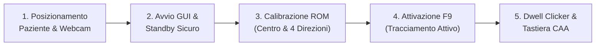

# 📄 ISTRUZIONI PER L'USO (IFU) — STEADYMOTION AI PRO
### Dispositivo Medico SaMD (Software as a Medical Device) — Classe I
**Conforme all'Allegato I, Capitolo III (Punto 23) del Regolamento Europeo (UE) 2017/745 (MDR)**  
*Documento Tecnico Ufficiale: IFU-SM-001 | Versione: 3.1 | Data di Emissione: Novembre 2026*

---

## 1. IDENTIFICAZIONE DEL DISPOSITIVO & FABBRICANTE

| Parametro | Descrizione Ufficiale |
| :--- | :--- |
| **Denominazione Commerciale** | **SteadyMotion AI Pro / Clinical SaMD Edition** |
| **Versione Software** | Release v3.0 / v3.1 LTS |
| **Classificazione MDR** | Dispositivo Medico SaMD — **Classe I** (Regola 11, Allegato VIII, MDR 2017/745) |
| **Destinazione d'Uso** | Interfaccia assistiva di puntamento cefalico, controllo computer e Comunicazione Aumentativa Alternativa (CAA) |
| **Fabbricante Legale** | Team di Sviluppo SteadyMotion AI |
| **Piattaforma Operativa** | Microsoft Windows 10 / 11 (64-bit) |
| **Supporto Tecnico & Vigilanza** | Canale di supporto ufficiale GitHub: `https://github.com/Ilponz/SteadyMotion-AI` |

---

## 2. DESTINAZIONE D'USO CLINICA (INTENDED PURPOSE)

SteadyMotion AI è un software medico assistivo progettato per ripristinare l'autonomia comunicativa, informatica e relazionale di pazienti affetti da gravi patologie neuro-motorie o disabilità fisiche degli arti superiori.

### 2.1 Popolazione di Pazienti Target
Il dispositivo è specificamente indicato per soggetti coscienti con preservate facoltà cognitive o di comprensione e con mobilità del capo o mimica facciale residua, affetti da:
1. **Sclerosi Laterale Amiotrofica (SLA)** in ogni stadio evolutivo;
2. **Tetraplegia o Tetraparesi** (traumatica, vascolare o post-anossica);
3. **Morbo di Parkinson e Parkinsonismi** con grave tremore a riposo e discinesie agli arti superiori;
4. **Tremore Essenziale Severo** refrattario a terapia farmacologica;
5. **Paralisi Cerebrale Infantile (PCI)** con quadri atetosici o spastici;
6. **Distrofie Muscolari progressive** (Duchenne, Becker, SMA);
7. **Sclerosi Multipla** con atassia o tremore intenzionale severo.

### 2.2 Ambiente Operativo Previsto
- **Ambiente Domiciliare:** postazione assistiva su letto articolato, carrozzina elettrica o scrivania.
- **Strutture Sanitarie & RSA:** reparti di neuroriabilitazione, degenze riabilitative, centri per l'autonomia assistiva e ausilioteche ASL/SSN.
- **Ambiente Scolastico & Lavorativo:** integrazione su postazioni PC per smart-working e didattica inclusiva (PEI / BES).

---

## 3. CONTROINDICAZIONI & AVVERTENZE CLINICHE

### 3.1 Controindicazioni Assolute
- **Stato di Coma o Locked-in Completo (CLIS)** privo di qualsiasi motilità oculare, cefalica o mimica facciale residua. In tali condizioni sono indicati sistemi BCI invasivi.
- **Gravi deficit cognitivi acuti** che impediscano la comprensione della relazione causa-effetto tra movimento cefalico e spostamento del cursore.

### 3.2 Controindicazioni Relative & Avvertenze Speciali
- **Epilessia Fotosensibile Non Controllata:** Se il paziente soffre di crisi epilettiche riflesse indotte da stimoli visivi, impostare la modalità grafica ad alto contrasto o tema "Dark Obsidian" e limitare la luminosità dello schermo.
- **Affaticamento Muscolare Cervicale (Head-Drop):** L'uso prolungato e continuo del capo può generare affaticamento dei muscoli paravertebrali e sternocleidomastoidei. SteadyMotion AI include il modulo *ErgonomicsMonitor* che rileva automaticamente la caduta cefalica anteriore o il decadimento posturale, invitando alla pausa.
- **Movimenti Spastici Involontari Improvvisi:** Se il paziente manifesta spasmi estensori cloni improvvisi, il sistema è dotato di *Freno Mioclonico* che sopprime istantaneamente le traiettorie ad altissima accelerazione ($v > 2200\text{ px/s}$), proteggendo da clic accidentali.

---

## 4. REQUISITI DI SISTEMA & CONFIGURAZIONE HARDWARE

### 4.1 Requisiti Minimi del Computer
- **Sistema Operativo:** Windows 10 (versione 19041 o successiva) oppure Windows 11 a 64-bit.
- **Processore (CPU):** Intel Core i3 (6ª generazione+) o AMD Ryzen 3 con supporto istruzioni AVX2.
- **Memoria RAM:** 4 GB minimi (8 GB raccomandati per multitasking con sintetizzatori vocali).
- **Spazio su Disco:** 250 MB liberi per l'installazione.
- **Scheda Audio & Altoparlanti:** Necessari per il feedback acustico di conferma clic e sintesi vocale TTS.

### 4.2 Requisiti e Posizionamento della Webcam
- **Tipologia:** Qualunque comune webcam commerciale USB o integrata con supporto formato video MJPG a 30 o 60 FPS (risoluzione $640 \times 480$ o $1280 \times 720$).
- **Distanza Operativa:** Posizionare la webcam tra **50 cm e 75 cm** dal volto del paziente.
- **Angolazione Ottimale:** Centrare la telecamera all'altezza degli occhi o leggermente sotto (fissata alla cornice superiore o inferiore del monitor).
- **Illuminazione Ambientale:** 
  - Condizione ideale: luce naturale diffusa frontale o lampada indiretta ($> 60\text{ lux}$).
  - Condizioni critiche: Evitare controluce acuto (finestre alle spalle). In ambienti con scarsa luminosità ($< 38\text{ lux}$), SteadyMotion AI attiva automaticamente il boost adattivo locale **CLAHE** sul canale luma YCrCb per mantenere l'aggancio biometrico.

---

## 5. PROCEDURA DI INSTALLAZIONE & PRIMO AVVIO (PER IL CAREGIVER)

### 5.1 Installazione Ufficiale con Bypass UAC (Consigliata)
1. Eseguire il file `installer/Installa_SteadyMotion_Pro.bat` (o il file di setup dedicato) con un doppio clic.
2. Alla richiesta di Windows UAC ("Vuoi consentire a questa app di apportare modifiche al dispositivo?"), cliccare **Sì**.
3. Il programma installerà i file in `C:\Program Files\SteadyMotion AI`, registrerà il certificato digitale di firma e creerà l'icona sul Desktop.
4. Questa modalità garantisce che il paziente tetraplegico possa controllare anche le finestre amministrative di Windows, Task Manager o schermate di sicurezza senza blocchi del cursore.

### 5.2 Modalità Portatile su Chiavetta USB
- Decomprimere l'archivio `SteadyMotion-AI-v3.0-Portable.zip` su una cartella del desktop o su chiavetta USB ed eseguire `SteadyMotion-AI.exe`.

---

## 6. GUIDA OPERATIVA PASSO-PASSO

### Passo 1: Standby di Sicurezza & Posizionamento
All'avvio, il software entra in modalità **STANDBY DI SICUREZZA (Disarmed)**. Il cursore del mouse **non si muove** e rimane completamente libero. Questo consente al caregiver di sistemare i cuscini, allineare la carrozzina e orientare il monitor senza generare clic involontari.

### Passo 2: Calibrazione Centro (Tasto Rapido F12)
1. Chiedere al paziente di guardare il centro dello schermo con postura rilassata e naturale.
2. Premere il tasto **F12** sulla tastiera (oppure il pulsante verde *"Centra Cursore"* nella GUI).
3. Il baricentro cefalico viene azzerato istantaneamente.

### Passo 3: Avvio del Tracciamento (Tasto Rapido F9)
- Premere il tasto **F9** per armare il dispositivo. Il banner passerà da giallo (*STANDBY*) a verde scuro (*TRACCIAMENTO ATTIVO*).
- Il cursore ora seguirà fedelmente i micromovimenti del naso e dello sguardo.

### Passo 4: Esecuzione dei Clic (Dwell Clicker Automatico)
- **Clic Sinistro:** Fermare il cursore sopra il pulsante o l'icona desiderata per un tempo pari al Dwell Time impostato (default: **$0.65\text{ secondi}$**). Un cerchio progressivo (HUD) mostrerà il caricamento visivo; al completamento verrà emesso un suono discreto e generato il clic.
- **Clic Destro, Doppio Clic, Trascina (Drag & Drop), Scroll:**
  - Il paziente può cliccare sull'icona della Palette Flottante sul bordo dello schermo per armare l'azione desiderata.
  - L'azione successiva verrà eseguita in modalità **One-Shot**, tornando automaticamente a Clic Sinistro per evitare errori.

### Passo 5: Comunicazione Aumentativa Alternativa (Tastiera Flottante CAA)
- Cliccare sulla scheda **"💬 CAA"** o premere il pulsante *"Apri Tastiera Flottante"*.
- La tastiera assistiva rimane sempre in primo piano:
  - Consente di comporre parole lettera per lettera con selezione Dwell;
  - Suggerisce istantaneamente le parole successive tramite il modello a **Bigramma** e predizione di parola (Keystroke Savings Rate $> 75\%$);
  - Include pulsanti di emergenza a comando rapido (*"AIUTO"*, *"HO SETE"*, *"HO DOLORE"*);
  - Pronuncia frasi ad alta voce mediante sintesi vocale neurale Microsoft Elsa in lingua italiana.

### Passo 6: Intervento di Emergenza del Caregiver (Co-Pilot WH_MOUSE_LL)
- Se il caregiver deve prendere il controllo del computer per aprire un file o chiudere un'applicazione:
  - È sufficiente **toccare o muovere fisicamente il mouse USB** della postazione.
  - Il sistema intercetta istantaneamente l'evento hardware e sospende il controllo cefalico per **2.0 secondi di cortesia**.
  - Non c'è alcuna "lotta" tra il paziente e il caregiver per il controllo del cursore.

---

## 7. GESTIONE DELLA LICENZA PRO & ATTIVAZIONE COMMERCIALE

1. Aprire la scheda **"🔐 Licenza Pro"** nel pannello di controllo.
2. Copiare il codice **Machine ID** (es. `SM-C531-405A`) cliccando sul pulsante `[📋 Copia ID]`.
3. Inviare il codice al fornitore autorizzato o inserirlo al momento dell'acquisto online.
4. Una volta ricevuta la chiave seriale (formato: `SM-PRO-XXXXXXXX-XXXX-XXXX`), incollarla nella casella e cliccare su **"🚀 Sblocca SteadyMotion Pro a Vita"**.
5. Tutte le funzionalità cliniche avanzate, l'esportazione delle relazioni sanitarie e il bypass UAC risulteranno permanentemente sbloccati.

---

## 8. MANUTENZIONE, PULIZIA E RISOLUZIONE DEI PROBLEMI

| Sintomo Riscontrato | Possibile Causa | Azione Correttiva Raccomandata |
| :--- | :--- | :--- |
| **Cursore immobile anche muovendo la testa** | Il software è in modalità Standby (F9) o la webcam è disconnessa. | Premere F9 per attivare il tracking. Verificare nel tab "⚙️ Temi" che la webcam sia selezionata e funzionante. |
| **Il cursore trema quando il paziente è fermo** | Guadagno eccessivo o tremore patologico non filtrato. | Nel tab "🎯 Puntamento", aumentare la *Zona Morta Trailing* (da 2.0 a 3.5 px) o selezionare il preset *"Parkinson & Tremore"*. |
| **Il paziente fatica a raggiungere i bordi dello schermo** | Range di movimento articolare ridotto o postura asimmetrica. | Aumentare il *Guadagno Generale* (da 2.8 a 4.0x) o eseguire la calibrazione asimmetrica ROM a 5 punti. |
| **Falsi clic accidentali durante lo spostamento** | Dwell Time troppo breve o soglia di movimento troppo tollerante. | Aumentare il tempo di sosta a 0.85 secondi e ridurre la tolleranza Dwell a 25 px. |
| **Tracciamento instabile o a scatti la sera** | Illuminazione insufficiente o controluce da una finestra. | Riorientare la fonte di luce verso il volto del paziente. Il modulo CLAHE si attiva in automatico ma richiede contrasto visibile. |
| **La tastiera o il tracciamento non clicca sulle finestre UAC** | Applicazione avviata in modalità portatile senza diritti UI Access. | Eseguire l'installazione completa tramite `installer/Installa_SteadyMotion_Pro.bat` in `C:\Program Files\`. |

---

## 9. VIGILANZA SANITARIA & SEGNALAZIONE INCIDENTI GRAVI

Ai sensi dell'**Articolo 87 del Regolamento UE 2017/745 (MDR)**:
- Qualsiasi malfunzionamento, difetto di fabbricazione, incidente grave o situazione che abbia causato o avrebbe potuto causare il deterioramento grave dello stato di salute del paziente o dell'utilizzatore **deve essere tempestivamente segnalato**:
  1. Al **Fabbricante del Software** tramite i canali di assistenza dedicati;
  2. All'**Autorità Competente dello Stato Membro** (in Italia: *Ministero della Salute — Direzione Generale dei Dispositivi Medici e del Servizio Farmaceutico*).

---

*SteadyMotion AI Pro — Documento Tecnico Approvato conforme a IEC 62304 / ISO 14971 / MDR 2017/745.*
